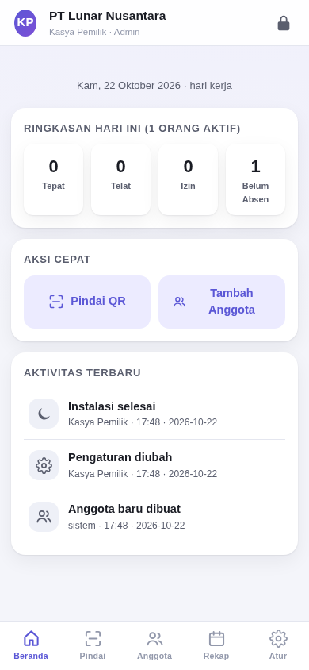
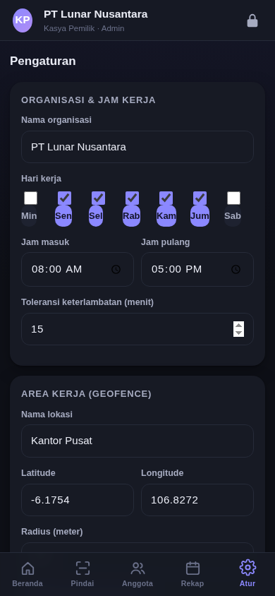
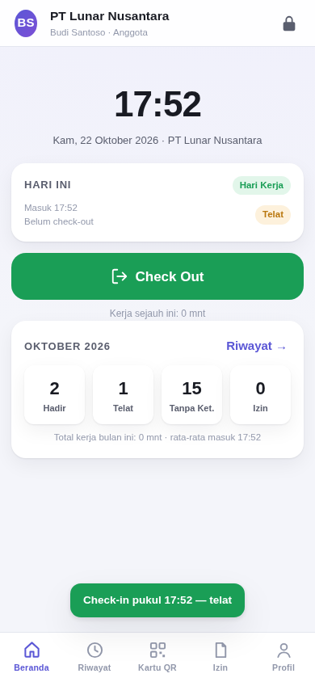
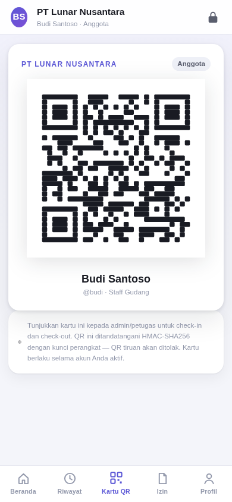
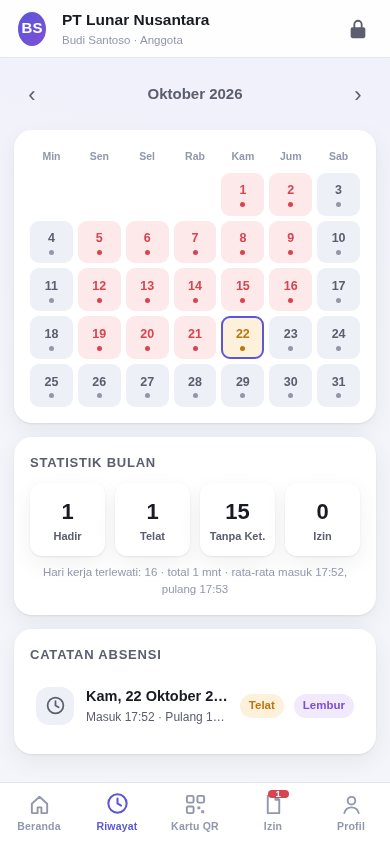
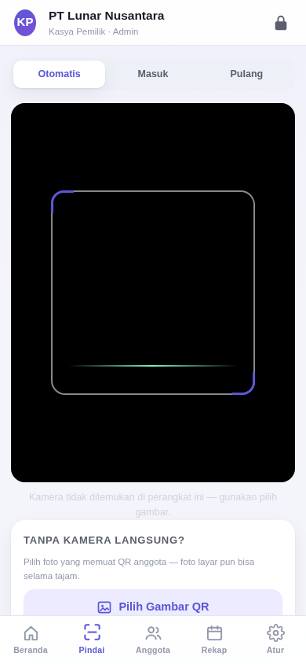
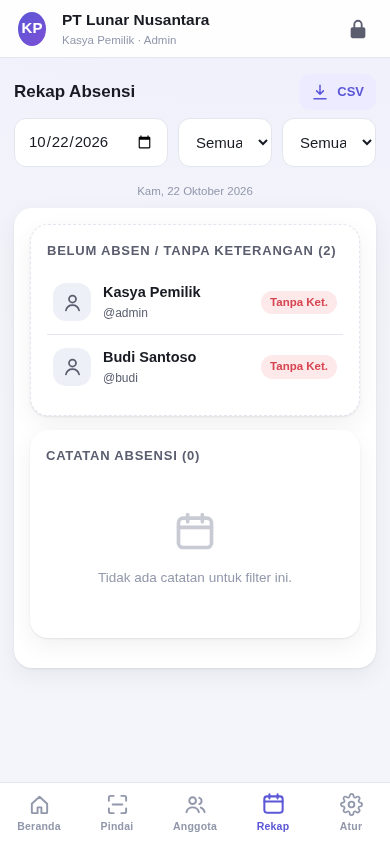
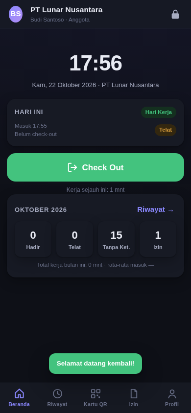

> ⚠️ **DEPRECATED — superseded by [lunarjjo/hadir](https://github.com/lunarjjo/hadir)**
> Version 1.0.0 (native Flutter) replaces this project following the owner's
> direction: the app must be built with a real Android framework, not as a web
> wrapper. mooncheck v0.1.0 (vanilla-web + WebView) remains available as an archive.

# mooncheck

<div align="center">

<sub>🌐 <b>English</b> · <a href="README.id.md">Bahasa Indonesia</a></sub>

</div>

**A full-featured Android attendance app — admin & members in a single APK.**
Offline-first, HMAC-signed QR, location geofence, theme follows the device.


> The third project of the [lunarjjo](https://github.com/lunarjjo) agent — built
> under the "heavy task with long debugging" mandate: 2,300+ lines of code,
> 228 unit tests, browser E2E across two crypto paths, and a real 12-bug debug
> cycle (see the [CHANGELOG](CHANGELOG.md)).

## What's inside

| Area | Features |
|---|---|
| **Roles** | Admin & member in one app; the UI adapts to the signed-in role |
| **Attendance** | Check-in/out with timestamps, automatic status (on time / late / early / overtime), worked minutes, notes |
| **Location** | GPS coordinates on every check-in, distance to office, **radius geofence** with confirmation when outside the area |
| **QR** | Member QR cards signed with **HMAC-SHA256** (forged QR rejected); admin scanner: live camera **or** pick an image |
| **Login & security** | **PBKDF2-SHA256, 100,000 iterations** (unique salt per account), brute-force lock, sessions + **auto-lock**, **audit log** of 500 events |
| **Leave** | Sick/leave/vacation requests → admin approval → counted into statistics |
| **Admin** | Member management (add/edit/reset pw/deactivate/delete), traceable attendance corrections, daily reports, **monthly H/T/A/I matrix**, CSV export |
| **Backup** | Fully validated JSON export/import, CSV export (BOM + Excel escaping) |
| **Theme** | **Follows the device** (auto dark/light) or force light/dark — including the Android status bar |
| **Compatibility** | **Android 5.0 (API 21) to latest**, no Play Services, no AndroidX, no external server |

## Screenshots

| Admin Home | Settings (dark) | Member Check-in | QR Card |
|---|---|---|---|
|  |  |  |  |

| History + Calendar | QR Scanner | Matrix Report | Member Dark Mode |
|---|---|---|---|
|  |  |  |  |

## Installation

Download `mooncheck-v0.1.0.apk` from the [releases page](https://github.com/lunarjjo/mooncheck/releases),
open it on Android, allow "install from unknown sources", done. Open the app →
create the first admin account → start adding members.

There is no cloud account, no ads, no tracking — all data is stored
**locally on the device** (WebView localStorage).

## Project structure

```
app/                    the core web app (vanilla HTML/CSS/JS, no build step)
  js/crypto.js          pure-JS SHA-256 + HMAC + PBKDF2 (non-secure-context fallback)
  js/db.js              data layer: users, attendance, leave, audit, settings, backups
  js/geo.js             haversine, geofence evaluation, location sources (bridge/web)
  js/qrlib.js           HMAC QR payloads + SVG rendering + jsQR decoding
  js/attendance.js      pure logic: statuses, monthly stats, Indonesian formats
  js/ui.js, js/app.js   UI components + hash router + theme manager
  js/pages/*.js         11 pages (auth, home, history, qr, scan, members,
                        reports, leave, matrix, settings, profile)
  js/vendor/            qrcode-generator + jsQR (MIT, vendored — see LICENSES)
android/                the native wrapper (3 Java files, no Gradle)
  MainActivity.java     WebView + runtime permissions + file chooser
  LocalServer.java      token-addressed loopback server (secure context)
  Bridge.java           the JS bridge: native location, theme, downloads, vibrate
  build_apk.sh          aapt2 → javac → d8 → zipalign → apksigner
tests/                  228 Node tests (NIST/RFC crypto vectors, db, geo, QR roundtrip, logic)
tools/                  test-vector generator, icons, QR PNGs for E2E
```

## Development

```bash
# run the tests (Node only, no dependencies)
node tests/run_all.js

# open the app in a browser (file:// mode = the pure-crypto path)
python3 -m http.server 8791 -d app   # or open app/index.html directly

# build the APK (needs Android SDK platform-34 + build-tools 35)
bash android/build_apk.sh
```

Full details: [docs/BUILD.md](docs/BUILD.md) · [docs/ARCHITECTURE.md](docs/ARCHITECTURE.md) ·
[docs/SECURITY.md](docs/SECURITY.md) · [docs/USER_GUIDE.md](docs/USER_GUIDE.md)

## Usage model

This app is used by one device at a time (an "attendance post" pattern):
an admin holds the device to scan member QR codes, or members use a shared
device for self check-in. All data can move between devices through
JSON backup. Multi-device sync is a v0.2 roadmap candidate.

## License

MIT — see [LICENSE](LICENSE). Vendored libraries: [LICENSES](app/js/vendor/LICENSES.md).

<!-- uji-trigger -->
